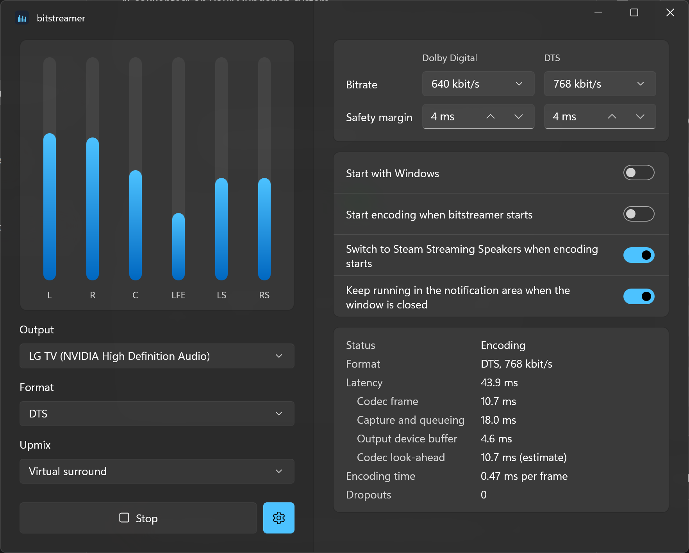

# bitstreamer

Real-time surround encoder for Windows. Games and players send 5.1 PCM to a
silent virtual playback device; bitstreamer captures it, encodes it to Dolby
Digital (AC-3) or DTS and sends the bitstream to an HDMI, DisplayPort or
S/PDIF output that accepts it. A software replacement for Dolby Digital Live
and DTS Connect, built for low latency.



## Requirements

* Windows 10 or 11, x64.
* [Steam](https://store.steampowered.com) installed. It provides the virtual
  speaker driver bitstreamer captures from; Steam does not need to be running.
* A receiver, soundbar or TV on HDMI, DisplayPort or S/PDIF that accepts Dolby
  Digital or DTS.

## Using it

1. Start `bitstreamer.exe`. If the *Steam Streaming Speakers* device is not
   installed yet, bitstreamer offers to install it and Windows asks for
   administrator permission.
2. Choose the **Output**, the **Format** and the **Upmix**, and press **Start**.

**Start** switches encoding on. bitstreamer encodes whenever the Steam device
is the Windows playback device: it sets that device to 5.1 at 48000 Hz and
sends what is played to it to the output. Select any other playback device in
Windows and bitstreamer stands by with every device released, so that device
(including the output itself) works as if bitstreamer were not running; select
the Steam device again and encoding resumes.

By default, Start also makes the Steam device the Windows playback device and
Stop switches back. With that option off (Settings), bitstreamer never changes
the playback device: together with *Start with Windows* and *Start encoding
when bitstreamer starts* it then sits in the background and encodes whenever
you pick the Steam device yourself.

**Upmix** decides what happens to stereo sound. Real 5.1 sound is never changed.

* **Off**: stereo plays on the front left and right only.
* **Quad speakers**: stereo is also played on the surround speakers.
* **Virtual surround**: the sound is split into six frequency bands and each
  is placed on its own. Sound both channels share (typically speech) moves
  towards the centre, sound they carry out of phase moves to the surrounds,
  ambience is added to the surround of its own side, and the low end feeds
  the subwoofer.

The meters show what is sent to the output, after upmixing. Only outputs whose
driver accepted Dolby Digital or DTS are listed. Only one instance runs at a
time.

The gear button opens **Settings** beside the main column: the bitrate and the
safety margin for each format, start-up options, and the measured latency of
the running session. Changes apply as you make them.

## How it behaves

* **Latency.** Measured from timestamps on the audio itself. On the
  development machine (NVIDIA HDMI to an LG TV) it was about 55 ms for Dolby
  Digital and about 40 ms for DTS, measured at a 2 ms margin. The default is
  now 4 ms, which should add about 2 ms (not re-measured). Of the Dolby
  Digital figure, 32 ms is the codec's frame
  length. The receiver's own decoding delay is not included.
* **Safety margin.** How long a frame is ready before the output needs it.
  Larger is safer, smaller is faster. The default is 4 ms.
* **Late frames.** If a frame is not ready in time, an encoded frame of
  silence is sent in its place, so the receiver stays locked and the gap is one
  frame long. The small extra delay is removed again over the next seconds by
  playing up to 0.5 % fast.
* **Clock drift.** The same small speed adjustment keeps the virtual device
  and the output in step, since they run on separate clocks.
* **Recovery.** If a device disappears or stalls, bitstreamer reopens it when
  it is back.

## Limits

* Decoding on a receiver has not been confirmed by ear in a controlled test.
* Tested on one machine and one output device only.
* DTS uses FFmpeg's DCA encoder, which FFmpeg marks experimental. In a
  round-trip decode its LFE channel comes back about 7 dB too quiet.

## Building

Requirements: Visual Studio 2022 or newer with the *Desktop development with
C++* workload (includes CMake, Ninja, vcpkg and NuGet). No other Visual Studio
component is needed.

```powershell
powershell -ExecutionPolicy Bypass -File .\build.ps1 -Test -Package
```

The script builds the core library and the tests with CMake, then the app
(`src\app`, WinUI 3) with MSBuild. The first build compiles FFmpeg through
vcpkg and downloads the Windows App SDK from NuGet; later builds reuse both.
The app is in `build\app\bin`, the ZIP package in `build`.

The app's layout is XAML that is parsed when the window opens
(`src\app\Layout.h`), so no XAML compiler is involved. The Windows App SDK
runtime is shipped beside the app; nothing has to be installed to run it.

The automated tests need no audio hardware: they drive the encoder with a
simulated clock and check channel routing, the bitstream format, clock-drift
handling, late-frame handling and recovery.

## License

MIT for bitstreamer's own code. The package also contains FFmpeg (LGPL) and
Microsoft's Windows App SDK and Visual C++ runtimes (Microsoft licences,
redistributable); see
[THIRD_PARTY_NOTICES.md](THIRD_PARTY_NOTICES.md). Dolby, Dolby Digital and DTS
are trademarks of their owners; this project is not certified or endorsed by
them.
